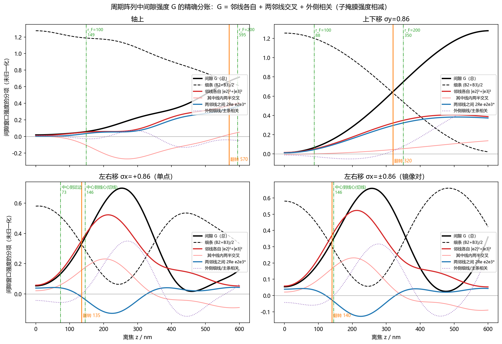
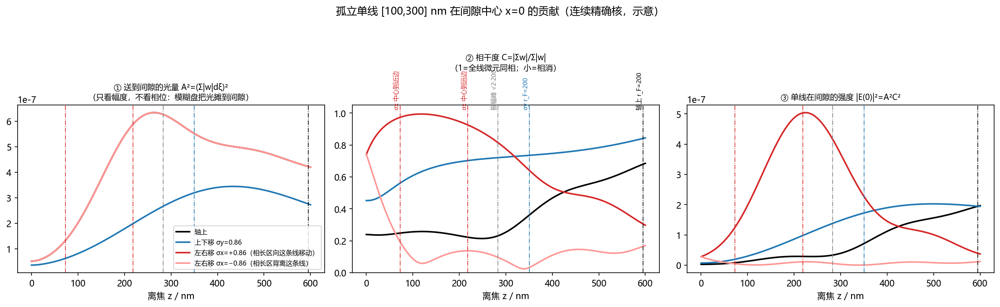

# 间隙为什么变亮：邻线的相干增长与三类源点的典型尺度（2026-11-19）

> **结论先行**
>
> 1. **基本成立。**三种源点下，间隙变亮几乎都来自“两条邻线送到间隙的场”，外侧细线和主条的贡献只占 −8%～+15%。
>    但“邻线”要分两层看：
>    - 轴上、上下移：两条邻线**对称**，在间隙中心的场严格相等、永远同相。所以单线的增长被“两线交叉项”原样复制一份，
>      两者各占增量的约一半（轴上 56% + 52%，上下移 48% + 45%）。**真正决定快慢的仍是单条邻线自身的相干增长。**
>    - 左右移：每个源点只让**一条**邻线在间隙相长，邻线自身项占增量的 106%～112%，两线交叉项为 −21%～−24%（抵抗）。
> 2. **“相消 → 相长被加快”只对一半。**单条邻线在间隙的强度可以精确拆成两个因子：
>    $$|E_{\rm line}(0)|^2=\underbrace{A^2}_{\text{送到间隙的光量}}\times\underbrace{C^2}_{\text{微元相干度}}.$$
>    - **送光量 $A$** 只由核的幅度决定，**轴上和左右移完全相同**；上下移的弦更短，送光量更少。
>    - **相干度 $C$** 才是“相消 → 相长”。三种源点的差别几乎全在这里：
>      轴上 C 在 300 nm 以内一直约 0.24，到 600 nm 才升到 0.69；上下移从 0.45 平缓升到 0.70（200 nm）；
>      左右移在焦面就有 0.74，50～200 nm 内 ≥0.94。
>    - 所以左右移在焦面上**并不是“相消而暗”**，而是“光还没送到间隙”。离焦后模糊盘把光送过来，载波又让这些光同相，间隙迅速变亮。
> 3. **每种源点都有一个“到达”判据，给出的深度与模拟翻转只差 4%～9%：**
>    - 轴上：Fresnel 带半宽 $r_F$ 长到邻线中心 $d_c=200$ nm，$z=2nwd_c/\lambda=595$ nm（模拟 570 nm）。
>    - 上下移：同一判据，$\kappa=k_{z0}$，$z=350$ nm（模拟 320 nm）。
>    - 左右移：相长区中心滑到邻线中心，$z=d_c/\tan\theta_s=146$ nm（模拟 135/140 nm）。
>      这比 v2 文档第 4 节用的“横移 $p/4$”判据（73 nm）更合理，详见第 4.3 节。

| 文件 | 内容 |
|---|---|
| 计划 | `docs/methods/gap-growth-scales-20261119.md`（冻结） |
| 脚本 | `src/gap_growth_scales.py`（约 18 s，复用 `inline_interline_coherence.py` 的引擎分账与 `hz_kernel_zones.py` 的精确核） |
| 产物 | `outputs/gap_growth_scales_20261119/`：S1 周期分账、S2 孤立单线、`summary.json` |
| 上一版 | `docs/inline-interline-coherence-20261118.md`（v2，统一推导与频带视角） |

状态标注：**已验证**＝精确数值或解析核对通过；**有条件支持**＝与数值相差 ≤15%，或只定性一致；**推断**＝未单独验证；**未知**＝不能解释。

---

## 0. 几何与记号

- λ=193 nm，NA=1.35，n=1.436。横向波矢用 $\sin$ 单位：$k_x=NA\,\sigma_x$，$k_z=\sqrt{n^2-k_x^2-k_y^2}$。
- 观察点取间隙中心 $x=0$，右邻线 bar3 占 $[100,300]$ nm，左邻线 bar2 关于 $x=0$ 对称。
  - 三个距离：近边 $d=100$、线心 $d_c=200$、远边 $d=300$ nm。
  - 线宽 $w=200$，节距 $p=400$。注意 $d_c=w=p/2$，后面几个判据会因此重合。
- 单线在间隙的场 $E_{\rm line}(0)=\int_{100}^{300}w(\xi;0)\,d\xi$，其中 $w(\xi;x)=e^{i2\pi f_{sx}(\xi-x)}h_{z,\sigma_y}(x-\xi)$（同 v2 第 1.1 节）。
- 三种源点：轴上；上下移 σy=0.86；左右移 σx=+0.86（相长区朝 bar3 移动）。σx=−0.86 是它的镜像。

---

## 1. 间隙强度的精确分账（周期阵列）

**做法。**用子掩膜强度相减求出每一项（$2\mathrm{Re}\,e_ae_b^*=I(a\cup b)-I(a)-I(b)$），窗口为 $G=0\pm25$ nm，闭合误差 <1e-10：
$$G=\underbrace{G[|e_2|^2]+G[|e_3|^2]}_{\text{邻线各自}}+\underbrace{G[2\mathrm{Re}\,e_2e_3^*]}_{\text{两邻线之间}}+G[\text{外侧相关}],\qquad
|e_k|^2=\text{两半自项}+\text{线内两半交叉}.$$

**从零焦到首次翻转，间隙强度的增量 ΔG 怎么分（已验证，模型内）：**

| 光源 | 翻转 | ΔG | 邻线各自 | 其中线内两半交叉 | 两邻线之间 | 外侧相关 | 邻线合计 |
|---|---|---|---|---|---|---|---|
| 轴上 | 570 | 0.647 | 0.364（56%） | +0.022（3%） | 0.334（52%） | −0.051（−8%） | 108% |
| 上下移 σy=0.86 | 320 | 0.635 | 0.306（48%） | +0.049（8%） | 0.285（45%） | +0.044（7%） | 93% |
| 左右移 σx=+0.86 单点 | 135 | 0.278 | 0.295（106%）：bar3 +0.317，bar2 −0.022 | +0.136（49%） | −0.058（−21%） | +0.041（15%） | 85% |
| 左右移 σx=±0.86 镜像对 | 140 | 0.278 | 0.312（112%） | +0.145（52%） | −0.066（−24%） | +0.032（12%） | 88% |

“邻线合计”＝邻线各自＋两邻线之间，即 $|e_2+e_3|^2$ 的增量。



*图 S1｜黑实线为间隙 G，黑虚线为细条 (B2+B3)/2，两者相交即翻转（橙线）。红为邻线各自，粉为其中的线内两半交叉，蓝为两邻线交叉，紫点线为外侧相关。绿点划线是第 2～4 节推出的到达深度。*

**怎么读这张表**

- **轴上、上下移：两邻线交叉项是单线项的“镜像复制”。**
  - 核 $h_{z,\sigma_y}$ 是偶函数，bar2 与 bar3（连同周期复制）关于 $x=0$ 对称，所以在间隙中心 $e_2(0)=e_3(0)$，于是
    $$|e_2+e_3|^2=4|e_2|^2,\qquad 2\mathrm{Re}\,e_2e_3^*=|e_2|^2+|e_3|^2 .$$
  - 两线交叉项**不是另一种机制**，它只是把单线的相干增长放大一倍（窗口 ±25 nm 平均后略小于单线项：0.334 对 0.364）。
  - 所以“间隙变亮 = 单条邻线在间隙的相干增长（×2）”在这两种情况下成立。
- **左右移：没有镜像对称。**
  - 源点 +σx 只让 bar3 在间隙相长（z=200 nm 时 $|e_3|^2=0.505$），bar2 几乎不贡献（0.012）。
  - 两线交叉项 $2|e_2||e_3|\cos\Delta\psi$ 很小，相位差 $\Delta\psi$ 在 125～330 nm 内为钝角，所以是负的、起抵抗作用。
  - 镜像源点 −σx 让 bar2 相长，结果对称。
- **线内两半交叉：三种情况差别最大（见第 3 节）。**
  - 轴上在 30～555 nm 内为负，即同一条邻线的近半与远半在间隙相消，周期中最小值约 −0.26（z≈270 nm）。
  - 上下移始终为小正值。
  - 左右移为大正值，占 ΔG 的一半。
- 按冻结判据（“邻线各自”≥80%），只有左右移满足。轴上和上下移满足的是“邻线合计”，而合计中的另一半是由对称性复制出来的同一个量。

另外，翻转还需要细条变暗（轴上 B 从 1.275 降到 0.657），本文只分析间隙一侧。

---

## 2. 单线的两个因子：送光量 $A$ 与相干度 $C$

**定义（精确恒等式）。**
$$A(z)=\int_{\rm line}|w(\xi;0)|\,d\xi=\int_{100}^{300}|h_{z,\sigma_y}(\xi)|\,d\xi,\qquad
C(z)=\frac{\big|\int_{\rm line}w\,d\xi\big|}{\int_{\rm line}|w|\,d\xi}\in[0,1],\qquad |E_{\rm line}(0)|^2=A^2C^2 .$$

- **$A$：只看幅度**，表示模糊盘把多少光摊到了间隙位置，与相位无关。载波 $e^{i2\pi f_{sx}\xi}$ 的模为 1，所以
  **左右移的 $A$ 与轴上严格相同**（图 S2 ① 中红、黑两线重合）。
- **$C$：只看相位**，表示这些光是否同相。$C=1$ 时全线微元同相（相长），$C$ 小则相消。



*图 S2｜孤立单线 [100,300]（连续精确核，不含周期复制，只用于看尺度）。① 送光量 $A^2$；② 相干度 $C$；③ $|E(0)|^2=A^2C^2$。点划线为第 3～4 节的解析深度。*

| z / nm | 0 | 50 | 100 | 150 | 200 | 250 | 300 | 400 | 600 |
|---|---|---|---|---|---|---|---|---|---|
| $A$（轴上 = 左右移） | 0.23 | 0.30 | 0.45 | 0.61 | 0.74 | 0.79 | 0.78 | 0.72 | 0.65 |
| $A$（上下移） | 0.19 | 0.22 | 0.29 | 0.36 | 0.42 | 0.48 | 0.53 | 0.58 | 0.52 |
| $C$ 轴上 | 0.24 | 0.24 | 0.26 | 0.25 | 0.23 | 0.21 | 0.25 | 0.47 | 0.69 |
| $C$ 上下移 | 0.45 | 0.52 | 0.61 | 0.66 | 0.70 | 0.71 | 0.72 | 0.75 | 0.84 |
| $C$ 左右移 +σx | 0.74 | 0.94 | 0.99 | 0.99 | 0.95 | 0.88 | 0.78 | 0.53 | 0.30 |
| $C$ 左右移 −σx | 0.74 | 0.32 | 0.09 | 0.09 | 0.13 | 0.13 | 0.07 | 0.11 | 0.17 |

（$A$ 的单位取核积分的原始单位，只比较相对大小。）

**要点**

- 0～250 nm 内，三种源点的 $A$ 都在增长：离焦把光从线上摊到间隙。这一步是**共同的**，不分源点。
- 轴上和左右移的 $A$ 完全相同，翻转早晚（570 对 140 nm）**全部来自 $C$**：轴上的光送到了，但相位互相抵消；左右移送来的光是同相的。
- 上下移的 $A$ 更小（弦短，进入瞳的光少），但 $C$ 比轴上高得多，乘积仍然更快变大。
- 对用户的第二个问题：
  - 上下移确实是“更快地把相消变成相长”。
  - 左右移在焦面上 $C=0.74$，本来就不算相消；它的间隙变暗是因为光没送到（$A$ 小）。
    离焦时 $A$ 增长，载波又把 $C$ 推到 ≈1，所以间隙变亮得最快。

---

## 3. 典型尺度的推导（一）：所有源点共有的尺度

### 3.1 焦面核宽度：零焦时间隙为什么暗

零焦时 $h_0(u)=\int_{-c}^{c}e^{i2\pi Fu}dF=2c\,\mathrm{sinc}(2cu)$，零点位于 $u_m=m/(2c)$：
$$u_1=\frac{\lambda}{2NA\sqrt{1-\sigma_y^2}}=\begin{cases}71.5\ \text{nm} & \text{轴上、左右移}\\ 140\ \text{nm} & \text{上下移 }\sigma_y=0.86\end{cases}$$

- **轴上**：邻线 [100,300] 横跨 sinc 的第 2～4 瓣，正负交替，大部分抵消，$C_0=0.24$。旁瓣幅度 $\propto1/u$ 很小，所以 $A_0$ 也小。
- **上下移**：第一零点外推到 140 nm，近边 100～140 nm 仍在主瓣，抵消较少，$C_0=0.45$。
- **左右移**：核同轴上，但每个微元多了载波 $e^{i2\pi f_{sx}\xi}$，周期 $\lambda/(NA\sigma_x)=166$ nm。
  sinc 的符号每 71.5 nm 翻一次（符号周期 143 nm），与载波周期接近，载波把一部分负瓣“翻正”，所以 $C_0=0.74$。
  这时间隙暗主要是因为 $A_0$ 小，而不是相消。（已验证：表中 $C_0$ 为数值结果。）

### 3.2 离焦起效深度：离焦相位何时不可忽略

离焦相位在积分弦端点达到 π/2 时，核开始明显偏离焦面形状。积分弦的端点都落在 NA 圆上，所以端点处 $k_z=\sqrt{n^2-NA^2}=0.490$：
$$z_D=\frac{\lambda}{4\,(k_{z0}-\sqrt{n^2-NA^2})}=\begin{cases}51\ \text{nm} & \text{轴上、左右移}\ (k_{z0}=n;\ \text{傍轴 }n\lambda/2NA^2=76)\\ 136\ \text{nm} & \text{上下移}\ (k_{z0}=0.845)\end{cases}$$

上下移的弦起点 $k_{z0}$ 已经低于 $n$，弦两端的 $k_z$ 差更小，所以离焦要更深才起效。
这一点与第 4.2 节“上下移相长区变宽更快”并不矛盾：后者比的是二阶曲率 κ，见下文。

### 3.3 模糊盘边缘到达邻线：光何时开始送到间隙

精确核的阴影（模糊盘）半宽等于离焦乘以积分弦端点的射线斜率：
$$u_g=z\tan\theta_{\rm edge},\qquad \tan\theta_{\rm edge}=\frac{NA\sqrt{1-\sigma_y^2}}{\sqrt{n^2-NA^2}}=\begin{cases}2.76 & \text{轴上、左右移}\\ 1.41 & \text{上下移}\end{cases}$$

模糊盘边缘到达距离 $d$ 的深度为 $z=d/\tan\theta_{\rm edge}$：

| | 近边 100 | 线心 200 | 远边 300 |
|---|---|---|---|
| 轴上、左右移 | 36 | 72 | 109 |
| 上下移 | 71 | 142 | 213 |

（傍轴阴影只有 $0.94z$，会把这些深度高估约 3 倍。）这些深度对应图 S2 ① 中 $A$ 开始快速增长的区段。

### 3.4 送光量的峰：高 NA 的“射线密度”

对瞳面频率做驻相，可得阴影内核的幅度：

- 落在 $u$ 处的光来自射线斜率 $t=\tan\theta=u/z$ 的那一个频率，单位长度上的能量等于频率被拉伸程度的倒数：
  $$|h(u)|^2\approx\frac{dF}{du}=\frac{1}{z\,d\tan\theta/dF}.$$
- 由 $\tan\theta=\lambda F/\sqrt{k_{z0}^2-\lambda^2F^2}$ 得 $d\tan\theta/dF=\lambda(1+t^2)^{3/2}/k_{z0}$，于是
  $$|h(u)|^2\approx\frac{k_{z0}}{\lambda z\,(1+t^2)^{3/2}}=\frac{k_{z0}}{\lambda u}\cdot\frac{t}{(1+t^2)^{3/2}},\qquad t=\frac uz .$$
- 固定 $u$、改变 $z$：$t/(1+t^2)^{3/2}$ 在 $t=1/\sqrt2$ 时最大，即
  $$z_A=\sqrt2\,u=141,\ 283,\ 424\ \text{nm}\quad(u=100,200,300).$$

**物理含义。**离焦刚开始时，送到 $u=200$ nm 处的是瞳边缘附近的陡射线。这些射线在像面上被拉得很开，单位长度上的能量很少。
离焦加深后，到达同一位置的是较缓的射线，射线更密，送到的光更多。傍轴近似下 $|h|^2=n/(\lambda z)$ 单调下降，没有这个峰，因此这是**高 NA 效应**。

**核对。**
- 轴上和左右移：$A$ 实测峰在 265 nm，线心预测 283 nm，相差 6%（有条件支持）。
- 上下移：实测峰在 435 nm，与驻相预测不符（未知）。可能原因是弦短、Fresnel 数小，驻相幅度近似不成立。

---

## 4. 典型尺度的推导（二）：决定快慢的相干度尺度

### 4.1 轴上：Fresnel 带长到邻线中心

阴影内 $\arg h\approx-\pi\kappa u^2/(\lambda z)$（傍轴时 κ=n）。比较同一条邻线两半的质心 $u_\mp=d_c\mp w/4$ 处的相位差：
$$\Delta\psi_{\rm halves}=\frac{\pi\kappa}{\lambda z}\Big[(d_c+\tfrac w4)^2-(d_c-\tfrac w4)^2\Big]=\frac{\pi\kappa\,w\,d_c}{\lambda z}.$$
两半同相（$\Delta\psi<\pi/2$）的条件为
$$\boxed{z>z_C=\frac{2\kappa\,w\,d_c}{\lambda}}\qquad(w=d_c=p/2\ \text{时}\ z_C=\frac{\kappa p^2}{2\lambda},\ \text{等价于 }r_F=\sqrt{z\lambda/2\kappa}\ \text{长到}\ p/2).$$

整个过程分三段：
1. **$z<149$ nm**（$r_F<100$，相长区还没碰到邻线）：邻线处在啁啾的外圈，正负抵消，$C\approx0.24$。
2. **149～595 nm**（近边已进入第一带，远边还在第二带）：近半与远半相位相反，线内两半交叉为负，周期计算中最小值约 −0.26（z≈270），所以 $C$ 一直停在约 0.25。
3. **$z>595$ nm**：两半同相，$C$ 上升（400 nm 时 0.47，600 nm 时 0.69），间隙变亮。

**核对。**
- 孤立单线两半交叉项回正在 555 nm，预测 595 nm，相差 7%（有条件支持）。
- 周期模拟首翻转 570 nm，与 595 nm 相差 4%。
- 两邻线由对称性同步，所以两线交叉项也在这一尺度上增长（图 S1 左上，红、蓝两线同步）。

### 4.2 上下移：同一判据，κ 更小

上下移的截面是 $k_y=NA\sigma_y$ 处的 Ewald 圆，中心曲率更大：$\kappa=k_{z0}=\sqrt{n^2-NA^2\sigma_y^2}=0.845$（轴上 1.436）。代入同一判据：
$$z_C=\frac{2k_{z0}wd_c}{\lambda}=350\ \text{nm},\qquad r_F=100\ \text{的深度}=\frac{2k_{z0}\cdot100^2}{\lambda}=88\ \text{nm}.$$

**与轴上的不同之处：线内两半交叉从不变负（已验证，图 S1 右上粉线）。**原因有两点（推断）：
- 焦面核本来就宽（第一零点 140 nm），近半一开始就在主瓣里；
- 模糊盘边缘只以 $1.41z$ 的速度扩张，远半要到 z≈213 nm 才被照到。而那时 $\Delta\psi_{\rm halves}=\pi\kappa wd_c/(\lambda z)\approx0.82\pi$，已经接近同相，所以“近半亮、远半反相”的阶段几乎不存在。

因此 $C$ 从 0.45 平缓升到 0.84，没有明显的转折。
- 周期模拟首翻转 320 nm，与 350 nm 相差 9%（有条件支持）。
- 350 nm 只能作为量级判据，不像轴上那样对应 $C$ 的一个明显拐点。

### 4.3 左右移：相长区中心横扫邻线

微元相位 $\Psi(\xi)=2\pi f_{sx}\xi+\arg h(-\xi)$。由 $d\arg h(u)/du=2\pi F(u)$，载波在 $F(u)=f_{sx}$ 处正好抵消啁啾的局部频率，得到驻相点
$$\xi^*(z)=z\tan\theta_s,\qquad\tan\theta_s=\frac{NA\,\sigma_x}{k_z}=1.374,$$
相长区半宽 $r_F=\sqrt{z\lambda n^2/(2k_z^3)}$（$\kappa=k_z^3/n^2=0.293$）。

| 事件 | 条件 | 深度 $z=d/\tan\theta_s$ | 此时 $r_F$ |
|---|---|---|---|
| 中心进入邻线（近边） | $\xi^*=100$ | 73 nm | 155 nm |
| 中心到达邻线中心 | $\xi^*=d_c=200$ | **146 nm** | 219 nm |
| 中心离开邻线（远边） | $\xi^*=300$ | 218 nm | 268 nm |

**为什么全线同时相长。**这三个深度上 $r_F$ 都大于线宽的一半（100 nm）。只要中心落在线内，整条邻线都在第一带里。
线上相位偏差最大约 $\tfrac{\pi}{2}(100/r_F)^2\le0.21\pi$，所以 $C\ge0.94$。
- 实测：50～200 nm 内 $C\ge0.94$，120 nm 时最大 0.99；中心离开后 $C$ 下降（250 nm 时 0.88，300 nm 时 0.78）。（已验证）
- 实测中心比理论快 4～9%（v2 第 1.3 节），所以 $C$ 的平台比 73～218 nm 略早。

**单线强度的峰。**$|E|^2=A^2C^2$：$A$ 一直增长到 265 nm，$C$ 在 218 nm 后下降，所以峰落在两者之间。
孤立单线的峰在 225 nm，周期阵列中的“邻线各自”项峰在 215 nm。（已验证）

**翻转判据（有条件支持）。**用“相长区中心到达邻线中心”$z=d_c/\tan\theta_s=p/(2\tan\theta_s)=146$ nm，与单点模拟翻转 135 nm、镜像对 140 nm 相差 4～8%。
- **与 v2 文档的区别**：v2 第 4 节用的是“横移 $p/4$”，得到 73 nm，偏早。现在看，73 nm 只是中心**刚进入**邻线；此时 $C$ 已高，但 $A$ 还只有峰值的一半左右，间隙尚未亮过细条。
- 新判据与周期阵列的弦公式 $\lambda/(4\Delta k_z)=115$ nm 不是同一个推导，数值也不同。146 nm 更接近模拟，可能是巧合，也可能因为它同时包含了 $A$ 的增长（推断，未单独证明）。

### 4.4 两条邻线之间：何时同相

- **轴上、上下移**：对称性保证 $e_2(0)=e_3(0)$，所以两线在间隙中心**始终同相**。两线交叉项的尺度就是单线相干尺度（595/350 nm），不需要另外的判据。
- **左右移**：单个源点只让一条邻线落在相长区里。另一条邻线在 −σx 方向的啁啾中自我抵消（−σx 一行的 $C\approx0.1$），两线交叉项小且符号随相对相位变化，在 125～330 nm 内为负（抵抗）。

---

## 5. 总结表

**表 A｜典型尺度（nm）**。观察点为间隙中心，邻线 [100,300]。“实测”来自 S1/S2，括号内为与预测的偏差。

| 尺度 | 公式 | 轴上 | 上下移 σy=0.86 | 左右移 σx=0.86 | 实测 | 状态 |
|---|---|---|---|---|---|---|
| ① 焦面核第一零点 | $\lambda/(2NA\sqrt{1-\sigma_y^2})$ | 71.5 | 140 | 71.5（载波周期 166） | 焦面相干度 $C_0$：0.24 / 0.45 / 0.74 | 已验证 |
| ② 离焦起效 | $\lambda/[4(k_{z0}-\sqrt{n^2-NA^2})]$ | 51（傍轴 76） | 136 | 51 | — | 解析 |
| ③ 模糊盘到达 近边/线心/远边 | $d/\tan\theta_{\rm edge}$ | 36/72/109 | 71/142/213 | 36/72/109 | $A$ 在这些深度后快速增长 | 有条件支持 |
| ④ 送光量峰 | $\sqrt2\,d_c$（高 NA 射线密度） | 283 | 283（不适用） | 283 | 265 / 435 / 265 | 轴上与左右移 −6%；上下移未知 |
| ⑤ 相长区碰到近边 | $2\kappa d^2/\lambda$；左右移为 $d/\tan\theta_s$ | 149 | 88 | 73 | 轴上此后线内两半变负 | 有条件支持 |
| ⑥ 单线全线同相 | 轴上/上下移 $2\kappa wd_c/\lambda$；左右移 $\xi^*\in$ 线内 | 595 | 350 | 73～218 | 轴上两半交叉回正 555（−7%）；上下移无拐点；左右移 $C\ge0.94$ 在 50～200 | 轴上、左右移有条件支持；上下移仅量级 |
| ⑦ 单线在间隙的强度峰 | $A^2C^2$ 的峰 | >600 | 500 | 225（周期 215） | — | 已验证（数值） |
| ⑧ 两邻线关系 | 对称性 | 始终同相，交叉项 ≈ 单线项 | 同左 | 只一条相长，交叉项为负 | 52% / 45% / −24% 的 ΔG | 已验证 |
| ⑨ 实空间翻转判据 | 轴上/上下移 $r_F=d_c$；左右移 $\xi^*=d_c$ | 595 | 350 | 146 | 模拟 570 / 320 / 135～140 | 有条件支持（4～9%） |

**表 B｜一句话机制**

| 源点 | 送光量 $A$ | 相干度 $C$ | 两邻线 | 间隙变亮靠什么 |
|---|---|---|---|---|
| 轴上 | 与左右移相同，265 nm 达峰 | 低（≈0.25）持续到 ~300 nm，595 nm 附近才同相 | 对称同相，单线项 ×2 | 等 Fresnel 带长到邻线中心，最慢 |
| 上下移 | 更少（弦短），435 nm 达峰 | 焦面已 0.45，平缓升高 | 对称同相，×2 | κ 小，带变宽更快；焦面核宽 |
| 左右移 | 与轴上相同 | 焦面 0.74，50 nm 后 ≥0.94 | 只有一条相长，交叉项抵抗 | 载波抵消啁啾，相长区扫过邻线，送到的光全部同相，最快 |

**对用户问题的直接回答**

- “间隙强度增长能否归结为邻线对间隙的相干增长？”**能**（邻线合计占 85%～108%）。
  但轴上和上下移是两条邻线对称地一起增长（交叉项是复制），左右移是每个源点一条邻线、另一条略为抵抗。
- “上下移、左右移都是加快相消 → 相长？”
  - 上下移：是。
  - 左右移：只对一半。焦面上它本来就不算相消（$C_0=0.74$），间隙暗是因为光没送到。离焦后送光量与轴上完全一样地增长，
    区别在于载波让这些光同相，而轴上的光彼此抵消。

## 6. 限制

- 第 2～4 节的 $A$、$C$ 用孤立单线和连续核，只用于提取尺度；第 1 节的分账来自周期精确计算。两者的峰位相差约 10 nm（225 对 215 nm）。
- 送光量峰的驻相幅度公式对上下移不成立（实测 435 对 283），原因未单独验证。
- 左右移的“中心到线心”判据与模拟吻合，但与级次公式（115 nm）的关系尚未推导清楚。
- 只分析了间隙一侧；细条变暗是翻转的另一半，没有在本文展开。全部为标量模型。

## 复现

```powershell
& '../../.venv/Scripts/python.exe' -B src/gap_growth_scales.py
```
